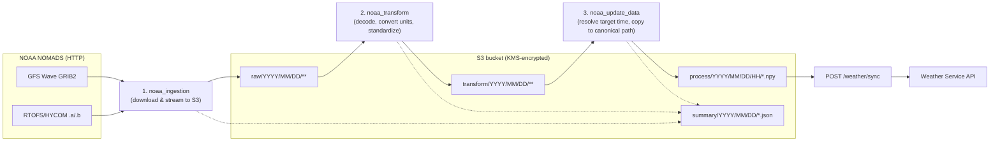

# NOAA ETL — Pipeline Overview

**Entry point:** [src/main.py](../src/main.py)
**Infra:** [template.yaml](../template.yaml) (AWS SAM/CloudFormation) · [Dockerfile](../Dockerfile) · [Makefile](../Makefile)

## Task Description

This service is a scheduled batch ETL that pulls raw NOAA ocean/wave forecast model
output (GFS Wave + RTOFS/HYCOM), converts it into compact, standardized NumPy arrays,
and publishes a time-indexed dataset consumed by a downstream weather service. It runs
once per day as a containerized task (2 vCPU / 16 GB, per `template.yaml`), scheduled
at `cron(0 10 * * ? *)` (10:00 UTC).

The pipeline is three sequential stages, each implemented as a `task/` module and
executed in order from `main()`:

1. **Ingestion** ([noaa_ingestion.md](./noaa_ingestion.md)) — downloads raw GRIB2/HYCOM
   files from NOAA NOMADS and streams them to `raw/`.
2. **Transform** ([noaa_transform.md](./noaa_transform.md)) — decodes raw formats,
   applies unit conversions and grid standardization, writes per-variable `.npy`
   files to `transform/`.
3. **Update** ([noaa_update_data.md](./noaa_update_data.md)) — resolves the correct
   file for each absolute UTC hour/variable and copies it into the canonical
   `process/{yyyy}/{mm}/{dd}/{hh}/{variable}.npy` tree, then triggers a sync
   notification to the weather service.

Each stage produces a JSON run summary under `summary/` and logs success/failure
counts; `main()` runs them strictly in sequence (transform depends on ingestion's
output, update depends on transform's output).

## I/O (Pipeline-Level)

**External input:** NOAA NOMADS production HTTP endpoints for GFS Wave and RTOFS.

**Configuration (env-driven, see [src/core/config.py](../src/core/config.py)):**
- `S3_BUCKET` — destination bucket (required).
- `WEATHER_URL` — downstream weather service base URL (required); pipeline `POST`s
  `{WEATHER_URL}/weather/sync` after publishing.
- `DOWNLOAD_DATE` — target UTC date (defaults to yesterday at 00:00 UTC).
- `NOAA_FORECAST_DAYS_DOWNLOADS` — forecast horizon in days (default 8, max 8).
- `MAX_CONCURRENT_TASK_DOWNLOAD` / `_TRANSFORM` / `_UPDATE` — per-stage concurrency
  caps (defaults 7 / 10 / 15).
- `SENTRY_DSN`, `ENVIRONMENT` — optional error monitoring.

**S3 layout (single bucket, prefix-partitioned, lifecycle-managed per `template.yaml`):**

| Prefix | Produced by | Lifecycle |
|---|---|---|
| `raw/` | Ingestion | → Standard-IA (30d) → Deep Archive (60d) |
| `transform/` | Transform | → Standard-IA (30d) → Deep Archive (60d), expires 120d |
| `process/` | Update | current version retained indefinitely; old versions expire 90d |
| `summary/` | All stages | → Standard-IA (30d) |

**Final output:** the `process/` tree is the pipeline's deliverable — a per-hour,
per-variable set of small `.npy` arrays ready for direct consumption — plus a sync
notification to the weather service so it knows to reload.

## Physics Involved (Macro View)

The pipeline integrates two operational ocean/atmosphere forecast systems:

- **GFS Wave** — NOAA's global wind-wave spectral model, run every 6 hours, providing
  wind speed/direction and sea state (significant wave height, wind-wave and swell
  height/period/direction) on a 0.25° global grid.
- **RTOFS (HYCOM-based)** — NOAA's global ocean forecast system, run once daily,
  providing sea surface temperature and current velocity (decomposed into speed and
  direction) with both a hindcast window and a multi-day forecast. RTOFS/HYCOM's
  native grid is **tripolar** (a regular mesh in the Southern Hemisphere, but the
  Northern Hemisphere's polar singularity is split across two displaced poles placed
  over land) rather than a simple regular lat/lon grid, so the transform stage must
  resample it before it's usable like the other gridded variables.

The pipeline's own processing is limited to: unit conversion (m/s → knots), latitude
axis normalization, vector-to-magnitude/direction decomposition
($\sqrt{u^2+v^2}$, $\operatorname{atan2}$-based bearing), 16-point compass
discretization, and grid remapping — for HYCOM specifically, resampling the native
tripolar grid onto a standardized regular output grid via a precomputed
nearest-neighbor index table (`hycom_satocean_idx.npy`), applied as the first step of
every HYCOM variable's transform chain before any unit conversion or bucketing. See
[noaa_transform.md](./noaa_transform.md#why-a-remap-is-needed-hycoms-native-grid-is-tripolar)
for the full mechanism and supporting evidence.

## Extra Information

- **Runtime:** async Python (`asyncio`, `httpx` HTTP/2, `aiobotocore`/`aioboto3`),
  containerized (see [Dockerfile](../Dockerfile)), deployed as a scheduled AWS task
  via [template.yaml](../template.yaml).
- **Resilience:** every per-file operation in every stage is independently
  try/excepted and reported in the stage's JSON summary rather than aborting the
  whole run; HTTP downloads and S3 part uploads use exponential-backoff retry.
- **Observability:** structured logging via [src/core/logger.py](../src/core/logger.py)
  and optional Sentry error/performance monitoring (`SENTRY_DSN`).
- **Security:** S3 bucket is KMS-encrypted (customer-managed key), versioned, and
  fully blocks public access (per `template.yaml`).
- **Key dependencies:** `pygrib` (GRIB2 decoding), `numpy` (array processing),
  `httpx` (async HTTP), `aioboto3`/`aiobotocore` (async S3), `pydantic-settings`
  (config), `sentry-sdk` (monitoring).
